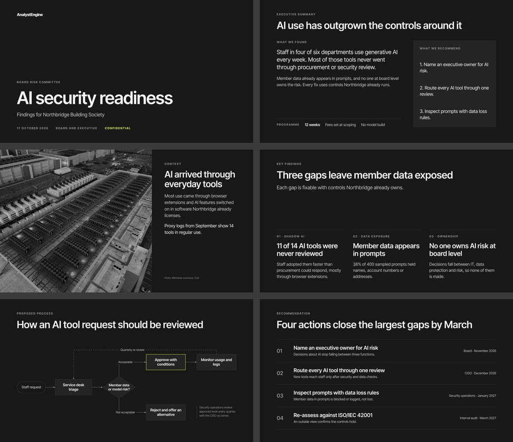
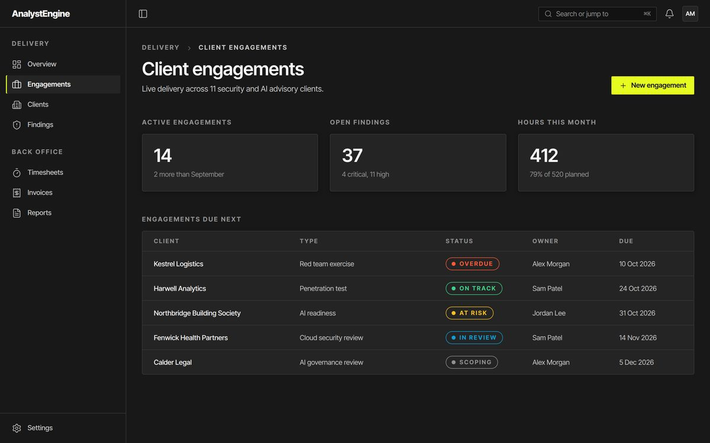
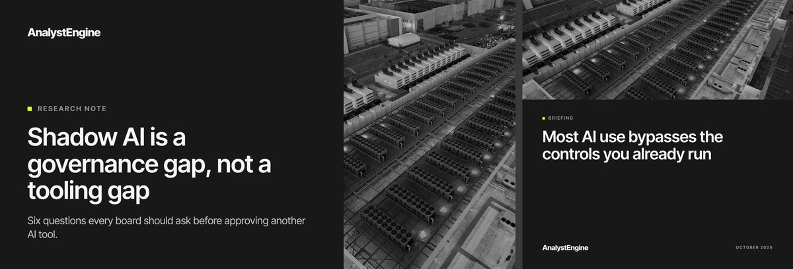
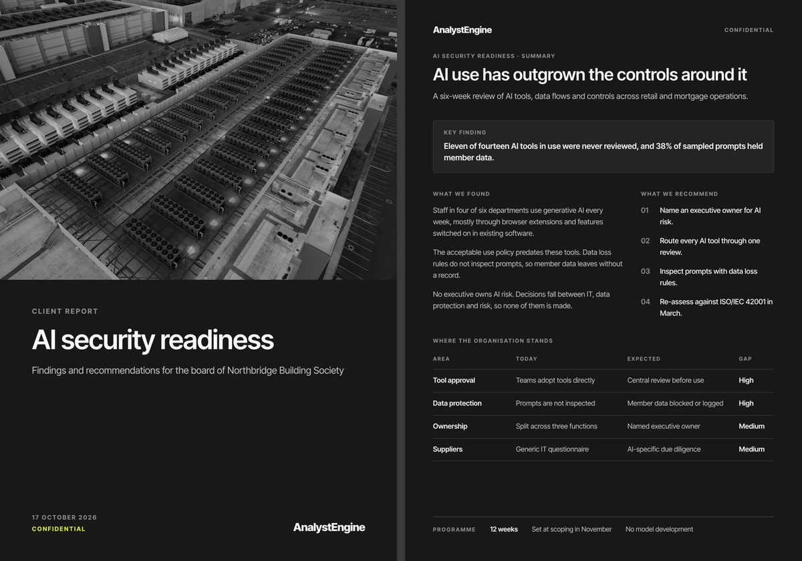
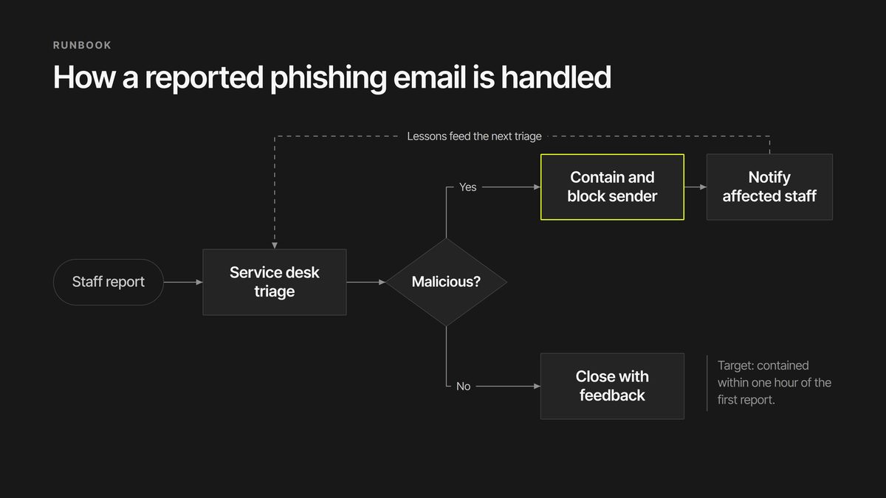
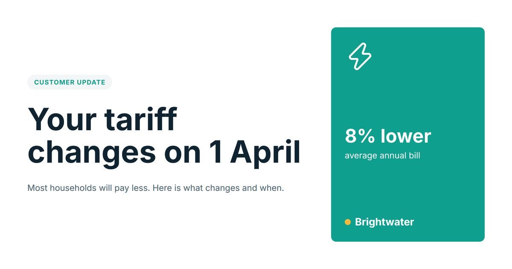

# aerender

Mock up any visual from a JSON scene, so you can agree it before you build it.

aerender is a command-line tool for AI agents and the people they work with. An agent describes a screen, a dashboard, a social graphic, an A4 page, a flow diagram or a slide deck as a small JSON scene, and aerender renders it to PNG or PDF. Both sides look at the same picture, ask for changes in plain words, and the agent applies them with one or two commands. Only once the visual is agreed does anyone write front-end code or build the real deck.

## The problem

Agents go straight to building. They write the React page or generate the PowerPoint file, and only then does anyone see it. Revising a built front end or deck is slow and expensive: the agent rereads large files, rewrites code or slides, and often breaks something else. There is no cheap, shared visual draft to agree first.

## How it works

```
  scene.json ──► resolve components ──► compile to HTML/CSS ──► Chrome ──► PNG · PDF · deck view
      ▲               ▲
      │               └── libraries: brand tokens, components, templates (*.lib.json)
      └── tree · set · insert · batch  (edits addressed by name path, e.g. "Card/Headline")
```

- A **scene** (`*.scene.json`) is a tree of frames, text, shapes, icons and component instances. Frames lay out like flexbox.
- **Libraries** (`*.lib.json`) hold a brand's tokens as variables, plus its components and templates.
- **Edits** address nodes by name path (`"Findings/Column[0]/Claim"`), including nodes inside component instances. `tree` gives the agent a compact outline instead of the raw JSON.
- **Chrome** lays the scene out and renders it. `render --deck` adds a scrollable `deck.html` and a single `deck.png` for review.

## Why it is powerful

- **Cheap revisions.** A typical text or layout change is one or two commands of about 200 to 600 characters, and lands right first time. A `batch` applies several edits atomically: all of them or none.
- **Brand-safe by construction.** Templates and components bind every colour, size and font to brand tokens. `lint --brand` flags off-palette colours, clipped or overflowing text, collapsed boxes and connectors that cross boxes.
- **Deterministic, offline renders.** Fonts and icons ship with the package, so the same scene renders the same pixels on any machine with Chrome.
- **Diagrams.** `connector` nodes join boxes with straight or right-angled lines, arrows and labels, routed from the real box positions after layout.
- **Photos with brand treatment.** `asset add` downloads an image next to the scene; `imageFilter: "mono"` gives it the brand's monochrome look without greying the text on top.
- **Clean hand-off.** `export spec` gives a build agent the text, components and tokens; `export html` gives HTML that keeps the CSS custom properties.
- **Works with any agent.** Everything is a CLI command. The skills in `skills/` teach Claude Code and other agents the workflow.

## Examples

Every example is in `examples/`, uses fictional data, and renders with `aerender render <file>`.

### A slide deck in deck view



```
aerender render examples/deck/deck.scene.json --deck   # slide PNGs, deck.pdf, deck.html, deck.png
```

### A revision loop on one slide

```
aerender tree examples/deck/deck.scene.json --node Findings
aerender set examples/deck/deck.scene.json "Findings/Headline" content="Three gaps put member data at risk"
aerender render examples/deck/deck.scene.json --node Findings
```

Several changes in one atomic step:

```
aerender batch examples/deck/deck.scene.json '[
  {"op":"set","path":"Findings/Column[0]/Claim","props":{"content":"11 of 14 tools were never reviewed"}},
  {"op":"move","path":"Recommendations","to":"/","index":1}]'
```

### A product dashboard



```
aerender render examples/dashboard/dashboard.scene.json
aerender set examples/dashboard/dashboard.scene.json "KPI findings/Value" content="41"
```

### Social and marketing graphics



```
aerender render examples/social/social.scene.json      # 1200x630 card and 1080x1080 square
```

### A4 documents



```
aerender render examples/one-pager/one-pager.scene.json --format pdf
```

### A flow diagram



```
aerender render examples/flow/flow.scene.json
aerender set examples/flow/flow.scene.json "Contain" x=860
```

### Bring your own brand



```
aerender tokens import brand.css --out brand/tokens.lib.json
aerender render examples/example-brand/social.scene.json
aerender lint examples/example-brand/social.scene.json --brand aerender:example
```

## Install

You need Node 22 or later and Chrome or Chromium.

```
npm install -g github:AnalystEngine/aerender
aerender doctor
```

`doctor` checks Node, Chrome, fonts, icons and the bundled libraries, renders a test scene, and prints a fix for anything missing. aerender looks for Chrome in `AERENDER_CHROME`, then on the `PATH` (`google-chrome`, `chromium`), then in a Playwright install (`npx playwright install chromium`).

Install the skills for your agent:

```
npx skills add AnalystEngine/aerender
```

Or copy `skills/aerender/` (and `skills/analystengine-brand/` if you need it) into a project's `.claude/skills/`. Each skill's setup step installs the CLI if it is missing.

## Quick start

```
echo '{"aerender":1,"imports":{"a":"aerender:analystengine/assets"},"children":[]}' > post.scene.json
aerender insert post.scene.json / '{"type":"ref","ref":"a:aSocial","name":"Card"}'
aerender set post.scene.json "Card/Headline" content="Review AI tools before staff adopt them"
aerender tree post.scene.json
aerender render post.scene.json                       # renders/card@2x.png
aerender lint post.scene.json --brand aerender:analystengine
```

Run `aerender <command> --help` for any command, and `aerender libs` for the bundled libraries.

## Brand kits

| Kit | Libraries | Purpose |
|---|---|---|
| `brands/analystengine/` | `aerender:analystengine/tokens`, `/ui`, `/assets`, `/slides` | AnalystEngine's design system: a full worked example covering screens, marketing graphics, documents, slides and diagrams |
| `brands/example/` | `aerender:example/tokens`, `/assets` | Brightwater, a fictional brand built from a 30-line CSS file |

### Creating a new brand

1. Write the client's colours, fonts, sizes and spacing as CSS custom properties in a `tokens.css`.
2. Run `aerender tokens import tokens.css --out tokens.lib.json`.
3. Build templates and components bound to those variables with `aerender batch`.
4. Check them with `aerender lint --brand tokens.css`.

The full guide is `skills/aerender/references/new-design-system.md`, and `brands/example/` is the worked example.

## The skills

- `skills/aerender/`: the generic skill. It covers setup, the edit and render workflow, and commands, with references on the format, composition for each kind of visual, and building a new design system.
- `skills/analystengine-brand/`: producing AnalystEngine-branded assets. It covers which library to use for which asset, the brand rules and voice, and a pre-delivery checklist.

## Limitations

- aerender draws mockups, not production assets. Final decks, print files and front-end code are built from the agreed mockup.
- Charts are not built in; draw simple ones with frames, or leave a placeholder.
- Connectors join the midpoints of box sides and do not route round obstacles; lint warns when a line crosses a box.
- Only the bundled fonts (Inter Tight, Inter, JetBrains Mono, Noto Sans) render exactly; other families fall back.
- Rendering needs Chrome or Chromium on the machine.

## Contributing and tests

```
npm ci
npm test            # integration tests: render the examples and fixtures in Chrome
npm run typecheck
```

[CLAUDE.md](CLAUDE.md) describes the architecture, how to add a node type or property, and the rules for keeping the skills in step with the CLI.

## Licence

To be confirmed.
